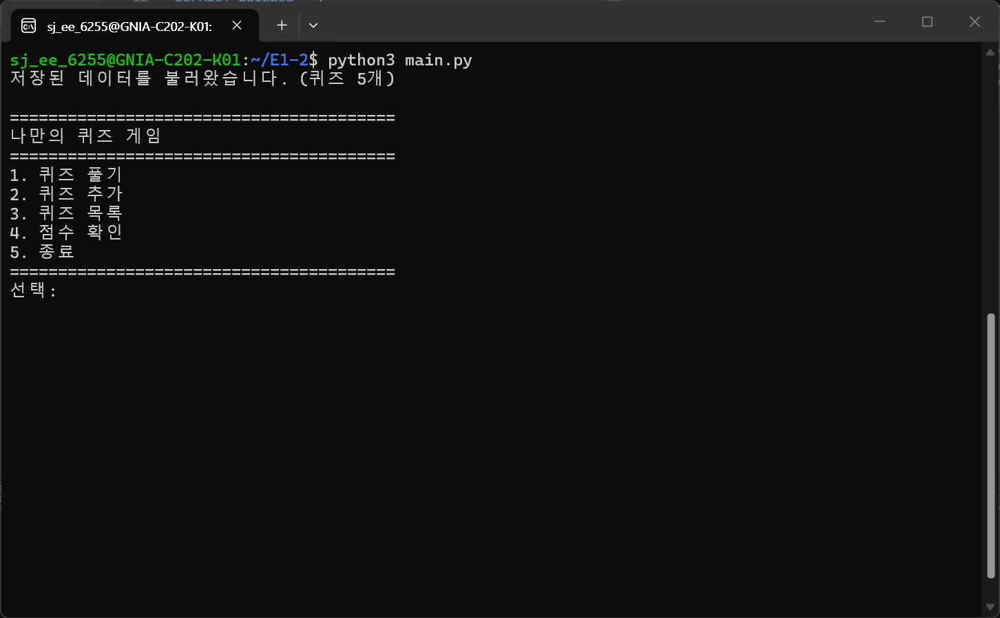
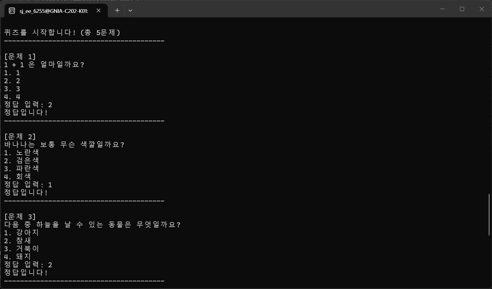
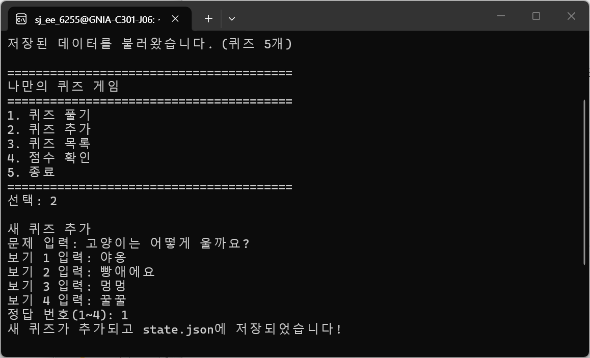
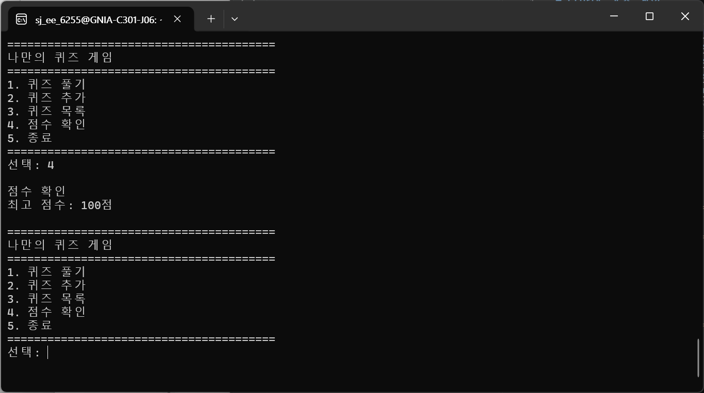
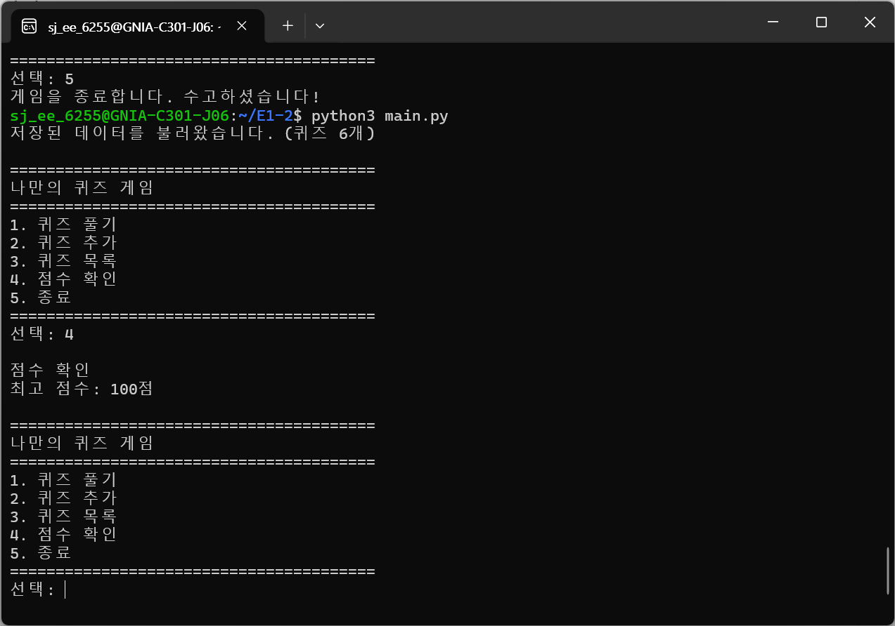

# 나만의 퀴즈 게임

터미널에서 번호를 입력해 객관식 퀴즈를 푸는 게임입니다.
퀴즈와 최고 점수는 `state.json` 파일에 저장되기 때문에, 프로그램을 껐다가 다시 켜도 그대로 남아 있습니다.

- **GitHub 저장소**: <YOUR_GITHUB_URL>

---

## 1. 프로젝트 개요

이 프로젝트는 **동작하는 프로그램을 처음부터 끝까지 직접 만들어 보는 것**이 목표입니다.
퀴즈 게임을 만들면서 아래 내용을 익혔습니다.

- Python 기초 문법 (변수, 조건문, 반복문, 함수)
- 클래스로 코드를 역할별로 나누는 방법
- JSON 파일에 데이터를 저장하고 불러오는 방법
- 오류가 나도 프로그램이 멈추지 않게 하는 예외 처리
- Git으로 작업 기록을 남기는 방법

**개발 환경**: Python 3.10 이상, 따로 설치하는 라이브러리 없이 Python 기본 기능만 사용

---

## 2. 퀴즈 주제와 선정 이유

**주제**: 누구나 풀 수 있는 아주 쉬운 기초 상식

**선정 이유**: 이번 과제에서 중요한 건 문제의 난이도가 아니라 **프로그램이 제대로 동작하는지**입니다. 문제가 쉬우면 고민 없이 빠르게 풀 수 있어서 퀴즈 풀기, 추가, 점수 저장, 다시 불러오기를 여러 번 반복해서 확인하기 좋습니다.

**기본 퀴즈 5문항** (`main.py` 위쪽의 `DEFAULT_QUIZZES`)

| 번호 | 문제 | 보기 | 정답 |
|---|---|---|---|
| 1 | 1 + 1 은 얼마일까요? | 1 / 2 / 3 / 4 | 2번 |
| 2 | 바나나는 보통 무슨 색깔일까요? | 노란색 / 검은색 / 파란색 / 회색 | 1번 |
| 3 | 다음 중 하늘을 날 수 있는 동물은 무엇일까요? | 강아지 / 참새 / 거북이 / 돼지 | 2번 |
| 4 | 손가락은 한 손에 몇 개가 있을까요? | 3개 / 4개 / 5개 / 6개 | 3번 |
| 5 | 밤하늘에서 빛나는 것은 무엇일까요? | 별 / 돌멩이 / 책상 / 양말 | 1번 |

---

## 3. 실행 방법

터미널에서 프로젝트 폴더로 이동한 뒤 아래 명령어를 입력합니다.

```bash
python3 main.py
```

또는 VS Code에서 `main.py`를 열고 오른쪽 위 ▶ 버튼을 누르면 실행됩니다.

---

## 4. 실행 화면

| 화면 | 스크린샷 |
|---|---|
| 개발 환경 (VS Code, Python 버전, Git 설정) |  |
| 메뉴 |  |
| 퀴즈 풀기 |  |
| 퀴즈 추가 |  |
| 퀴즈 목록 |  |
| 점수 확인 |  |
| 다시 실행해도 데이터 유지 |  |

**실행 예시** (`←` 뒤는 설명)
```text
$ python3 main.py
저장된 데이터를 불러왔습니다. (퀴즈 6개)    ← 지난번에 추가한 퀴즈까지 6개가 남아 있음

========================================
나만의 퀴즈 게임
========================================
1. 퀴즈 풀기
2. 퀴즈 추가
3. 퀴즈 목록
4. 점수 확인
5. 종료
========================================
선택: abc
숫자를 입력하세요.                          ← 글자를 넣으면 다시 입력
선택: 9
1~5 사이의 숫자를 입력하세요.               ← 없는 번호를 넣으면 다시 입력
선택: 1

퀴즈를 시작합니다! (총 6문제)
----------------------------------------

[문제 1]
1 + 1 은 얼마일까요?
1. 1
2. 2
3. 3
4. 4
정답 입력: 2
정답입니다!
...
결과: 6문제 중 5문제 정답! (83점)
```

---

## 5. 기능 목록

| 메뉴 | 하는 일 |
|---|---|
| 1. 퀴즈 풀기 | 저장된 퀴즈를 순서대로 내고, 맞았는지 틀렸는지 알려 준 뒤 마지막에 점수를 보여 줍니다. 최고 점수보다 높으면 새로 저장합니다. |
| 2. 퀴즈 추가 | 문제, 보기 4개, 정답 번호를 입력받아 새 퀴즈를 만들고 바로 파일에 저장합니다. |
| 3. 퀴즈 목록 | 지금 저장된 퀴즈를 전부 보여 주고, 정답 옆에 `(정답)`을 표시합니다. |
| 4. 점수 확인 | 최고 점수를 보여 줍니다. 아직 한 번도 안 풀었으면 "아직 퀴즈를 풀지 않았습니다"라고 알려 줍니다. |
| 5. 종료 | 게임을 끝냅니다. |

**그 밖에**
- 퀴즈가 하나도 없으면 "등록된 퀴즈가 없습니다"라고 알려 줍니다.
- 잘못 입력하면(빈 값, 글자, 없는 번호) 안내 문구를 보여 주고 다시 입력받습니다.
- `Ctrl+C`를 눌러 강제로 꺼도 저장하고 안전하게 종료합니다.

---

## 6. 프로그램 흐름

프로그램이 실행되면 아래 순서로 동작합니다.

```text
① python3 main.py 실행
        ↓
② QuizGame() 게임 객체를 만듦
        ↓
③ load_data() 가 state.json 을 읽음
     - 파일이 없으면 → 기본 퀴즈 5개로 시작
     - 파일이 있으면 → 저장된 퀴즈와 최고 점수를 불러옴
     - 파일이 깨졌으면 → 백업해 두고 기본 퀴즈로 시작
        ↓
④ run() 이 메뉴를 보여 주고 번호를 입력받음 (5번을 누를 때까지 반복)
     1 → play_quiz()       퀴즈 풀기
     2 → add_quiz()        퀴즈 추가
     3 → show_quizzes()    퀴즈 목록
     4 → show_best_score() 점수 확인
     5 → 종료
```

---

## 7. 파일 구조

```text
E1-2/
├── .gitignore    # Git에 올리지 않을 파일 목록
├── main.py       # 게임 코드 전체 (Quiz, QuizGame 클래스)
├── README.md     # 지금 보고 있는 설명서
└── state.json    # 퀴즈와 최고 점수를 저장하는 파일 (처음 실행하면 자동으로 생김)
```

---

## 8. 데이터 파일 설명 (state.json)

### 어디에 있고, 무슨 역할을 하나요?
- **위치**: 프로젝트 폴더 안의 `state.json`
- **역할**: 퀴즈 목록과 최고 점수를 저장합니다. 프로그램 안의 변수는 프로그램을 끄면 사라지지만, 파일에 저장해 두면 다시 켰을 때 그대로 불러올 수 있습니다.
- **인코딩**: UTF-8 (한글이 깨지지 않게 하는 저장 방식)

### 어떤 모양으로 저장되나요?
```json
{
    "quizzes": [
        {
            "question": "1 + 1 은 얼마일까요?",
            "choices": ["1", "2", "3", "4"],
            "answer": 2
        }
    ],
    "best_score": 80
}
```

| 이름 | 뜻 | 예 |
|---|---|---|
| `quizzes` | 퀴즈 목록 (여러 개를 담는 리스트) | `[ 퀴즈1, 퀴즈2, ... ]` |
| `question` | 문제 | `"1 + 1 은 얼마일까요?"` |
| `choices` | 보기 4개 | `["1", "2", "3", "4"]` |
| `answer` | 정답 번호 (1~4) | `2` |
| `best_score` | 최고 점수 (100점 만점) | `80` (아직 안 풀었으면 `null`) |

### 왜 이런 모양으로 만들었나요?
- 퀴즈는 개수가 늘어날 수 있고 순서대로 내야 하니까 **리스트**로 묶었습니다.
- 퀴즈 하나에는 문제, 보기, 정답이 있으니까 이름표를 붙여 **딕셔너리**로 묶었습니다.
- 사용자가 번호로 답하니까 정답도 **번호**로 저장해서 바로 비교할 수 있게 했습니다.
- 아직 안 풀었을 때 점수를 `0`으로 저장하면 "0점을 받은 것"과 헷갈리기 때문에 **`null`(값 없음)** 로 저장합니다.

### 언제 읽고, 언제 저장하나요?
- **읽기**: 프로그램을 시작할 때 한 번 (`load_data()`)
- **저장**: 값이 바뀔 때마다 바로 (`save_data()`)
  - 퀴즈를 추가했을 때
  - 최고 점수가 바뀌었을 때
  - `Ctrl+C` 등으로 프로그램이 중간에 꺼질 때

---

## 9. 설계 설명

### 왜 클래스를 썼나요?
쉽게 말하면, `Quiz`는 **문제 카드 한 장**이고 `QuizGame`은 **카드 묶음을 들고 게임을 진행하는 사람**입니다.

| 클래스 | 맡은 일 | 가진 값 | 하는 일 |
|---|---|---|---|
| `Quiz` | 퀴즈 한 문제 | 문제, 보기, 정답 | 문제 보여 주기, 정답 확인하기 |
| `QuizGame` | 게임 전체 | 퀴즈 목록, 최고 점수 | 메뉴, 퀴즈 풀기·추가·목록·점수, 저장·불러오기 |

- **관련된 것끼리 묶여 있어서 이해하기 쉽습니다.** 문제·보기·정답이 `Quiz` 하나에 들어 있어서, 게임 쪽에서는 `quiz.check_answer(번호)`만 부르면 채점이 됩니다.
- **같은 틀로 몇 개든 만들 수 있습니다.** 기본 퀴즈, 내가 추가한 퀴즈, 파일에서 불러온 퀴즈가 모두 같은 `Quiz` 틀로 만들어집니다.
- **고칠 곳을 찾기 쉽습니다.** 문제가 보이는 모양을 바꾸고 싶으면 `Quiz`의 `display()`만, 저장 방식을 바꾸고 싶으면 `save_data()`만 보면 됩니다.

### 함수만 썼다면 뭐가 달랐을까요?
함수만으로도 만들 수는 있습니다. 하지만 퀴즈 목록과 최고 점수를 **모든 함수가 같이 쓰는 변수(전역 변수)** 로 두어야 해서, 기능이 늘어날수록 "이 값을 어디서 바꿨지?"를 찾기 어려워집니다. 클래스를 쓰면 이 값들이 `self.quizzes`, `self.best_score`로 게임 객체 안에 모여 있어서 관리하기 쉽습니다.

### 기능은 어떤 기준으로 나눴나요?
**하는 일이 다르면 다른 메서드로** 나눴습니다.

| 하는 일 | 메서드 | 이렇게 나눠서 좋은 점 |
|---|---|---|
| 숫자 입력 검사 | `input_number()` | 메뉴 선택, 정답 입력, 정답 번호 등록에 **같은 검사가 필요해서** 한 번만 만들고 세 곳에서 씀 |
| 게임 진행 | `play_quiz()`, `add_quiz()`, `show_quizzes()`, `show_best_score()` | 메뉴 하나에 메서드 하나. `run()`은 번호에 맞는 메서드를 부르기만 함 |
| 저장 / 불러오기 | `save_data()`, `load_data()` | 파일 다루는 코드를 한곳에 모아 둠. 다른 곳에서는 `save_data()`만 부르면 됨 |

### 왜 JSON으로 저장했나요?
- **사람이 읽기 쉽습니다.** 메모장으로 열어도 무슨 내용인지 바로 보입니다.
- **파이썬 모양 그대로 저장됩니다.** 리스트 `[ ]`와 딕셔너리 `{ }`가 JSON에서도 거의 똑같이 생겨서, "퀴즈 목록 안에 퀴즈, 퀴즈 안에 보기 목록" 같은 구조를 그대로 저장할 수 있습니다.
- **따로 설치할 게 없습니다.** 파이썬에 기본으로 있는 `json`으로 `json.dump()`(저장), `json.load()`(불러오기)만 쓰면 됩니다.

---

## 10. 예외 처리

**예외 처리**란 오류가 생길 만한 곳에 미리 대비해서, 오류가 나도 프로그램이 멈추지 않게 하는 것입니다.

### 잘못 입력했을 때
| 입력 | 결과 |
|---|---|
| ` 1 ` (앞뒤에 공백) | 공백을 지우고 `1`로 처리 |
| 그냥 Enter | "빈 값입니다. 다시 입력하세요." |
| `abc` | "숫자를 입력하세요." |
| `9` (메뉴에 없는 번호) | "1~5 사이의 숫자를 입력하세요." |
| `0` (정답에 없는 번호) | "1~4 사이의 숫자를 입력하세요." |
| 문제나 보기를 빈 값으로 입력 | "문제는 비워둘 수 없습니다." |

안내 문구를 보여 준 뒤 **다시 입력받습니다.**

### 저장 파일에 문제가 있을 때
파일은 프로그램 밖에 있어서 누가 지우거나 잘못 고칠 수 있습니다. 그래서 `try/except`로 대비했습니다.

| 상황 | 처리 |
|---|---|
| 파일이 없음 (처음 실행) | 기본 퀴즈 5개로 시작하고 파일을 새로 만듦 |
| 파일 내용이 깨짐 (따옴표·쉼표가 빠짐, 필요한 값이 없음 등) | 깨진 파일을 `state_backup.json`으로 **복사해 둔 뒤** 기본 퀴즈로 다시 시작 |
| 저장이 안 됨 (폴더에 쓰기 권한이 없음 등) | 오류 문구만 보여 주고 게임은 계속 |

```text
데이터 파일에 문제가 있어 기본 퀴즈로 복구합니다. (Expecting property name enclosed in double quotes: line 1 column 2 (char 1))
손상된 원본은 state_backup.json 파일로 백업했습니다.
```

깨진 파일을 바로 덮어쓰지 않고 백업해 두는 이유는 **원래 데이터를 되살릴 수 있게** 하기 위해서입니다. `state_backup.json`을 열어 문제가 된 부분(오류 문구의 line, column 위치)을 고친 뒤 이름을 `state.json`으로 바꾸고 다시 실행하면 됩니다.

### 프로그램이 갑자기 꺼질 때
| 상황 | 처리 |
|---|---|
| `Ctrl+C`를 누름 | 저장한 뒤 "프로그램이 중단되어 데이터를 저장하고 안전하게 종료합니다." 출력 |
| 입력이 끊김 (EOF) | 위와 동일 |
| 다른 곳에서 프로그램을 끄라는 신호(SIGTERM)를 보냄 (예: `kill` 명령) | `handle_sigterm()`이 `Ctrl+C`를 누른 것처럼 바꿔 줘서, 위와 똑같이 저장 후 종료 |

---

## 11. 요구사항이 바뀌면 어디를 고치나요?

| 바꾸고 싶은 것 | 고칠 곳 |
|---|---|
| 점수 계산 방법 | `play_quiz()`의 `score = int(correct_count / total * 100)` |
| 보기 개수 (예: 4개 → 5개) | `add_quiz()`의 `range(1, 5)`, 정답 입력 범위 `1, 4` |
| 기본 퀴즈 내용 | 맨 위 `DEFAULT_QUIZZES` |
| 메뉴 추가 | `show_menu()`(화면), `run()`(번호별 기능) |
| 저장 파일 이름 | 맨 위 `DATA_FILE` |

---

## 12. 퀴즈가 1,000개 이상으로 많아진다면?

### 지금 방식의 한계
- 퀴즈를 **하나만 추가해도 파일 전체를 처음부터 다시 씁니다.**
- 프로그램을 켤 때 **모든 퀴즈를 한꺼번에 불러옵니다.**

### 직접 재 봤더니
| 퀴즈 수 | 저장 시간 | 불러오는 시간 |
|---|---|---|
| 1,000개 | 약 0.004초 | 약 0.005초 |
| 10,000개 | 약 0.04초 | 약 0.06초 |
| 100,000개 | 약 0.5초 | 약 0.7초 |

1만 개까지는 눈치챌 수 없을 만큼 빠르지만, 10만 개쯤부터는 퀴즈 하나 추가할 때마다 0.5초씩 기다려야 합니다. (컴퓨터마다 수치는 다를 수 있음)

### 해결 방법
데이터가 아주 많아지면 파이썬에 기본으로 들어 있는 데이터베이스인 `sqlite3`를 쓰면 됩니다. 파일 전체를 다시 쓰지 않고 **바뀐 퀴즈 하나만 저장하고, 필요한 문제만 꺼내 쓸 수 있습니다.**

---

## 13. Git 작업 기록

### 커밋 규칙
기능 하나를 완성할 때마다 커밋했고, 메시지는 `종류: 한 일` 형식으로 썼습니다.

| 종류 | 언제 | 예시 |
|---|---|---|
| `Feat` | 새 기능을 만들었을 때 | `Feat: 퀴즈 풀기 기능 구현` |
| `Fix` | 오류를 고쳤을 때 | `Fix: 점수 확인 오류 수정` |
| `Docs` | 문서를 고쳤을 때 | `Docs: README 작성` |

### 커밋 기록
```text
$ git log --oneline --graph
(여기에 실제 결과를 붙여넣으세요)
```

### 브랜치 만들고 합치기
퀴즈 풀기 기능은 `main`이 아닌 새 브랜치에서 만든 뒤 합쳤습니다.

```bash
git checkout -b feature/play-quiz   # 새 브랜치를 만들고 그 브랜치로 이동
git add main.py
git commit -m "Feat: 퀴즈 풀기 기능 구현"
git checkout main                   # main 브랜치로 돌아오기
git merge feature/play-quiz         # 새 브랜치에서 한 작업을 main에 합치기
```

- **브랜치를 나눈 이유**: 새 기능을 만드는 동안 오류가 나더라도 `main`은 항상 잘 돌아가는 상태로 두기 위해서입니다.
- **merge(병합)란?**: 다른 브랜치에서 한 작업을 지금 브랜치에 합치는 것입니다. 기능이 완성되면 `main`에 합칩니다.

### clone / pull 실습
GitHub 저장소를 다른 폴더에 복사(clone)해서 수정하고, 원래 폴더에서 그 수정 내용을 받아왔습니다(pull).

```bash
git clone <YOUR_GITHUB_URL> E1-2-clone   # 1) 다른 폴더에 저장소 복사
cd E1-2-clone
# 2) README에 한 줄 추가한 뒤
git add README.md
git commit -m "Docs: clone 실습"
git push origin main                     # 3) GitHub에 올리기

cd ../E1-2
git pull origin main                     # 4) 원래 폴더에서 바뀐 내용 받아오기
```

### 사용한 Git 명령어
| 명령어 | 하는 일 |
|---|---|
| `git init` | 지금 폴더를 Git으로 관리하기 시작 |
| `git add` | 커밋할 파일 고르기 |
| `git commit` | 지금까지 바꾼 내용을 기록으로 남기기 |
| `git push` | 내 컴퓨터의 기록을 GitHub에 올리기 |
| `git pull` | GitHub의 새 기록을 내 컴퓨터로 받아오기 |
| `git checkout` | 브랜치 만들기(`-b`) / 다른 브랜치로 이동 |
| `git merge` | 다른 브랜치의 작업 합치기 |
| `git clone` | GitHub 저장소를 통째로 복사해 오기 |

---

## 14. 과제 목표 Q&A

### Python 기초

**변수가 무엇이고, 왜 쓰나요?**
값에 이름을 붙여 저장해 두는 상자입니다. 값을 기억해 두거나 여러 번 쓸 때 사용합니다.
→ `correct_count = 0`으로 맞힌 개수를 기억하고, 맞힐 때마다 `correct_count += 1`로 늘립니다.

**`int`, `str`, `bool`, `list`, `dict`는 어떻게 다른가요?**
| 자료형 | 뜻 | 내 코드 예 |
|---|---|---|
| `int` | 정수 | 정답 번호 `2`, 점수 `80` |
| `str` | 글자 | 문제 `"1 + 1 은 얼마일까요?"` |
| `bool` | 참(`True`) / 거짓(`False`) | `check_answer()`의 결과 |
| `list` | 순서가 있는 목록 `[ ]` | 보기 `["1", "2", "3", "4"]` |
| `dict` | 이름표를 붙인 묶음 `{ }` | `{"question": ..., "answer": 2}` |

**`if/elif/else`는 어디에 썼나요?**
조건에 따라 다른 일을 할 때 썼습니다.
→ `run()`에서 입력한 메뉴 번호가 1이면 퀴즈 풀기, 2면 퀴즈 추가… 이렇게 번호마다 다른 기능을 실행합니다.

**`for`와 `while`은 어떻게 다른가요?**
- `for`: **몇 번 반복할지 정해져 있을 때** → 퀴즈를 처음부터 끝까지 하나씩 낼 때 (`play_quiz()`)
- `while`: **언제 끝날지 모를 때** → 사용자가 올바르게 입력할 때까지 계속 다시 물어볼 때 (`input_number()`)

**함수의 매개변수와 반환값은 어떻게 썼나요?**
함수에 재료(**매개변수**)를 넣으면 결과(**반환값**)를 돌려받습니다.
→ `input_number("선택: ", 1, 5)`처럼 안내 문구와 범위를 넣으면, 검사를 통과한 숫자를 돌려줍니다. 범위만 바꿔서 `input_number("정답 입력: ", 1, 4)`로도 씁니다.

### 클래스와 객체

**클래스가 무엇이고, 왜 쓰나요?**
객체를 만드는 **설계도**입니다. 관련된 값과 기능을 하나로 묶어 줍니다.
→ `Quiz` 설계도 하나로 문제 5개(객체 5개)를 똑같은 방식으로 만들었습니다.

**`__init__`과 `self`는 무슨 역할인가요?**
- `__init__`: 객체를 만들 때 **자동으로 실행되어** 처음 값을 넣어 줍니다. `Quiz(문제, 보기, 정답)`라고 쓰면 실행됩니다.
- `self`: **그 객체 자신**을 가리킵니다. 덕분에 문제마다 자기만의 `self.question`, `self.answer`를 가집니다.

**속성과 메서드는 무엇인가요?**
- **속성**: 객체가 가진 값 → `quiz.answer` (정답 번호)
- **메서드**: 객체가 하는 동작 → `quiz.display()` (문제 보여 주기), `quiz.check_answer()` (정답 확인)

### 파일 입출력

**파일을 열고, 읽고, 쓰는 과정은 어떻게 되나요?**
**열기 → 읽기 또는 쓰기 → 닫기** 순서입니다.
- `open(파일이름, "r")`은 읽기, `open(파일이름, "w")`는 쓰기로 엽니다.
- `with`를 쓰면 다 쓰고 나서 파일을 **자동으로 닫아 줍니다.**
→ `load_data()`에서 읽고, `save_data()`에서 씁니다.

**JSON이 무엇이고, 왜 쓰나요?**
데이터를 글자로 적어 두는 **약속된 형식**입니다. 사람이 읽기 쉽고, 파이썬의 리스트·딕셔너리와 모양이 거의 같아서 `json.load()`, `json.dump()`로 쉽게 불러오고 저장할 수 있습니다.

**`try/except`는 어떻게 썼나요?**
`try`에는 오류가 날 수 있는 코드를, `except`에는 오류가 났을 때 대신 할 일을 씁니다. 이게 없으면 오류가 나는 순간 프로그램이 멈춥니다.
- `abc`처럼 숫자가 아닌 걸 입력하면 → "숫자를 입력하세요" 후 다시 입력 (`input_number()`)
- 저장 파일이 깨져 있으면 → 백업 후 기본 퀴즈로 다시 시작 (`load_data()`)
- `Ctrl+C`를 누르면 → 저장 후 종료 (맨 아래 `if __name__ == "__main__":`)

